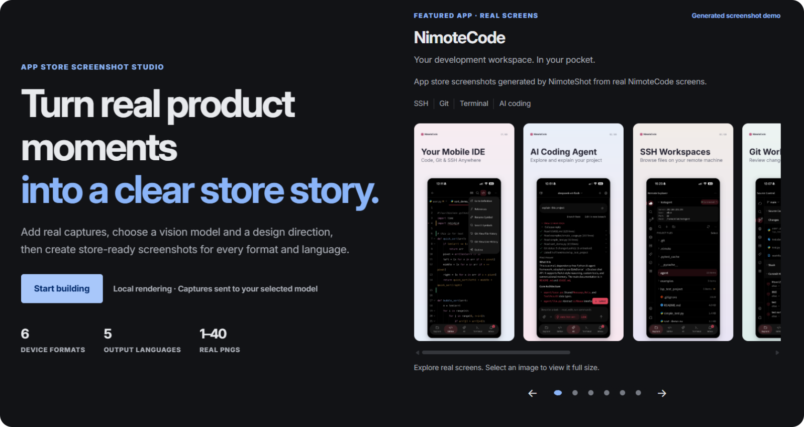

  

  <strong>Developer tools for mobile coding, remote workflows, and app launches.</strong>

  <a href="#about">About</a> &nbsp;·&nbsp;
  <a href="#nimotecode">NimoteCode</a> &nbsp;·&nbsp;
  <a href="#nimotehost">NimoteHost</a> &nbsp;·&nbsp;
  <a href="#nimoteshot">NimoteShot</a> &nbsp;·&nbsp;
  <a href="#connect">Connect</a>

## About

I'm **mobiledevlab**, an independent developer building tools that connect mobile development, remote workspaces, and AI coding agents. My focus is practical software with clear interfaces: a workspace to write code, a host runtime to keep work running, and a screenshot studio to prepare apps for launch.

Previously at **Huawei** · Graduate of **Southwest Jiaotong University**

## Featured projects

### NimoteCode

**Your development workspace on Android, iPhone, and iPad.**

Bring code editing, remote access, Git, and AI assistance into one mobile IDE.

- **Edit and navigate** local or remote projects from your phone or tablet.
- **Connect over SSH** to work with remote files and an interactive terminal.
- **Review Git changes** and collaborate with AI using your own provider.
- **Pair with NimoteHost** for host-side tasks, terminals, and coding agent sessions in compatible versions.

  <video src="https://github.com/user-attachments/assets/14c8bab8-ae16-4e15-8a8a-926ef2c747f4" controls muted playsinline width="420"></video>

**[Website](https://nimotecode.com)** · [Download](https://nimotecode.com/download) · [Documentation & examples](https://github.com/mobiledevloperlab/nimotecode)

*Free to start; commercial and closed source. The public repository provides documentation and examples. Built-in agent and Git write workflows are available through Early Access. AI requires your own provider key; provider charges may apply.*

### NimoteHost

**Keep tasks, terminals, and coding agent sessions running after clients disconnect.**

The open-source host companion to NimoteCode, with a standalone CLI and desktop manager for Linux, macOS, and Windows.

- **Continue work across disconnects** with host-side tasks and terminal sessions.
- **Access sessions and agent approvals** from compatible NimoteCode versions over an existing SSH connection.
- **Use it independently** through the desktop manager, RPC, or compatible MCP clients.
- **Run on your own infrastructure** without a Nimote account or public relay.

**[Source](https://github.com/mobiledevloperlab/nimotehost)** · [Releases](https://github.com/mobiledevloperlab/nimotehost/releases) · [Getting started](https://github.com/mobiledevloperlab/nimotehost#start-here)

*Open source under Apache-2.0. Configure SSH and third-party agent CLIs separately. Session persistence covers client disconnects; restarting Host or the OS does not restore task processes.*

### NimoteShot

**Turn real app captures into App Store and Google Play screenshots.**

An open-source screenshot studio for creating editable, localized store artwork for iPhone, iPad, and Android.

- **Start with real captures** and arrange them into store-ready layouts.
- **Refine copy and localization** manually or with optional AI assistance.
- **Preview and export locally**, with editable project files for future updates.

  

**[Source](https://github.com/mobiledevloperlab/nimoteshot)** · [Quick start](https://github.com/mobiledevloperlab/nimoteshot#quick-start) · [Contributing](https://github.com/mobiledevloperlab/nimoteshot/blob/master/.github/CONTRIBUTING.md)

*Free and open source under AGPLv3 or later. Requires Python 3.11+. Optional cloud AI services may incur provider charges.*

## Technologies

I work primarily with **Flutter and Dart** for app interfaces, **Rust** for native capabilities, and **Go and Python** for host services and developer tooling.

  &nbsp;&nbsp;
  &nbsp;&nbsp;
  &nbsp;&nbsp;
  &nbsp;&nbsp;
  &nbsp;&nbsp;
  &nbsp;&nbsp;
  

Flutter · Dart · Rust · Go · Python · Linux · Git · Firebase

## Connect

For product questions and community discussions, join Discord. For bugs and feature requests in open-source projects, use the issue tracker in the relevant repository.

**[X · @mobiledevlab](https://x.com/mobiledevlab)** · [Discord](https://discord.gg/tTxbpqYmhR) · [NimoteCode](https://nimotecode.com) · [Public repositories](https://github.com/mobiledevloperlab?tab=repositories)

<!-- Tech icons: Devicon (MIT); license: assets/tech/LICENSE -->
