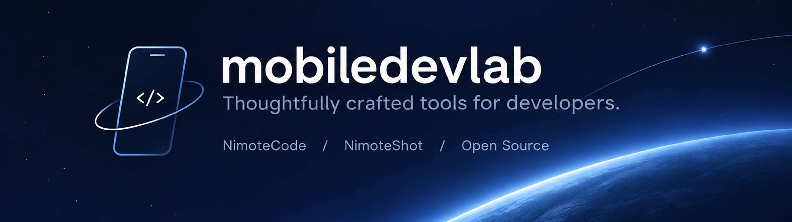
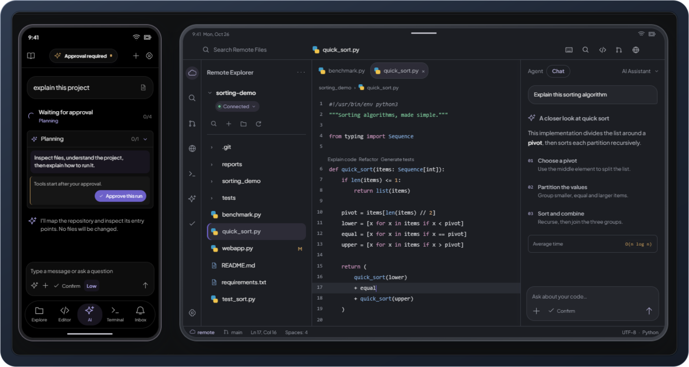
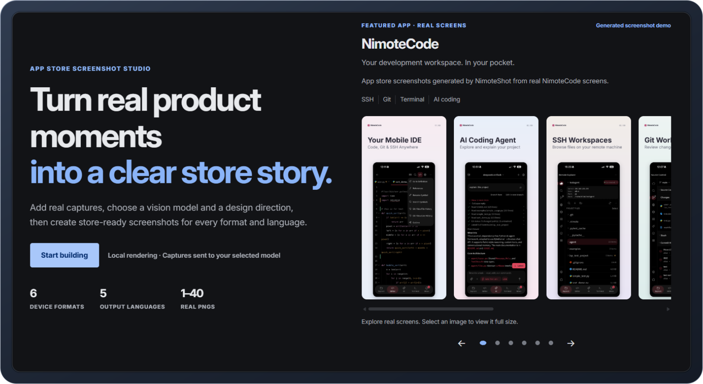

  

  <a href="#about-me">About</a> &nbsp;·&nbsp;
  <a href="#nimotecode">NimoteCode</a> &nbsp;·&nbsp;
  <a href="#nimoteshot">NimoteShot</a> &nbsp;·&nbsp;
  <a href="#connect">Connect</a>

## About me

I'm an independent developer working on mobile development, AI agents, and developer tools. I build NimoteCode and NimoteShot, with a focus on practical workflows and clear interfaces.

Previously at Huawei · Southwest Jiaotong University graduate

## Featured projects

### NimoteCode

**A mobile IDE for Android, iPhone, and iPad.** Edit local or remote projects, use an SSH terminal, review Git changes, and work with AI using your own provider. The built-in agent and Git write workflows are available through Early Access.

  

  
  

[Website](https://nimotecode.com) · [All downloads](https://nimotecode.com/download) · [Docs and examples](https://github.com/mobiledevloperlab/nimotecode)

*Free to start. NimoteCode is commercial and closed source; its public repository contains documentation and examples. AI requires your own provider key and may incur provider charges.*

### NimoteShot

**An open-source App Store and Google Play screenshot generator.** Turn real app captures into editable, localized store artwork for iPhone, iPad, and Android. Design manually or use optional AI assistance; previews and exports render locally.

  

**[Source](https://github.com/mobiledevloperlab/nimoteshot)** · [Quick start](https://github.com/mobiledevloperlab/nimoteshot#quick-start) · [Contribute](https://github.com/mobiledevloperlab/nimoteshot/blob/master/.github/CONTRIBUTING.md)

*Free and open source under AGPLv3 or later. Requires Python 3.11+. Cloud AI providers may charge for optional analysis.*

## Tech stack

  &nbsp;&nbsp;
  &nbsp;&nbsp;
  &nbsp;&nbsp;
  &nbsp;&nbsp;
  &nbsp;&nbsp;
  &nbsp;&nbsp;
  

Flutter · Dart · Rust · Python · Linux · Git · Firebase

## GitHub activity

**6** public repositories · **21** stars across them · Latest public push **5 Nov 2026**

Languages by code size in public repositories: Python 33.9% · Shell 15.1% · CSS 14.6% · JavaScript 13.6% · Astro 13.6% · Other 9.2%.

Snapshot: 6 Nov 2026 UTC · [View current activity](https://github.com/mobiledevloperlab?tab=overview)

## Connect

[X @mobiledevlab](https://x.com/mobiledevlab) · [NimoteCode website](https://nimotecode.com) · [Discord](https://discord.gg/tTxbpqYmhR)

<!-- Tech icons: Devicon (MIT); license: assets/tech/LICENSE -->
