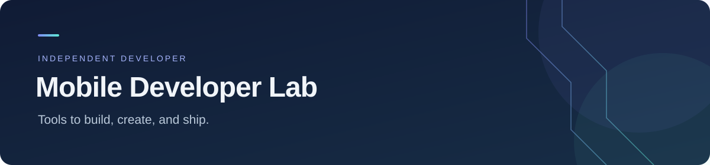
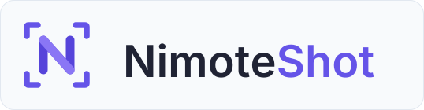

  

[About me](#about-me) · [Build NimoteShot](#nimoteshot) · [Get NimoteCode](#nimotecode) · [Connect](#lets-connect)

## About me

I'm an independent developer based in China and the creator of **NimoteShot** and **NimoteCode**. I build practical tools that help developers create, code, and ship their work.

I graduated from **Southwest Jiaotong University (SWJTU)** and previously worked at **Huawei**. My focus is on mobile development tools, SSH, local Linux, Git, and AI-assisted workflows. NimoteCode is my first product, shaped by continuous improvements and feedback from the people using it.

- **Build with me:** [NimoteShot](#nimoteshot), an open-source screenshot studio for app developers.
- **Try what I'm building:** [NimoteCode](#nimotecode), a development workspace for your phone or tablet.

  

## NimoteShot

  

**Create store screenshots. Build the tools together.**

Turn product captures into polished, localized screenshots for **App Store and Google Play**. Vision models help draft the copy; you edit the result and render the artwork locally.

**[Get started →](https://github.com/mobiledevloperlab/nimoteshot#quick-start)** · [Contribute](https://github.com/mobiledevloperlab/nimoteshot#development) · [Explore the source](https://github.com/mobiledevloperlab/nimoteshot)

  
  

  

- **Reach more users** — multilingual screenshots for iPhone, iPad, and Android.
- **Make it your own** — editable copy and layouts, visual styles, and PNG / ZIP exports.
- **Work your way** — local web studio or CLI, with cloud providers or local Ollama models.

### Join the open-source development

I'd love to build and maintain NimoteShot with fellow developers. Code, bug fixes, testing, translations, and documentation all help move the project forward.

1. **Try it on your app** using the [quick start](https://github.com/mobiledevloperlab/nimoteshot#quick-start) and [example screenshots](https://github.com/mobiledevloperlab/nimoteshot/tree/master/demo/nimotecode).
2. **Find something to improve** in the [open issues](https://github.com/mobiledevloperlab/nimoteshot/issues), or open an issue with your idea or bug report.
3. **Send a contribution** — read the [development instructions](https://github.com/mobiledevloperlab/nimoteshot#development), fork the repository, and open a pull request.

A [GitHub star](https://github.com/mobiledevloperlab/nimoteshot) or a shared example helps other app developers discover the project.

GNU AGPLv3. Rendering and exports stay local; cloud providers receive the inputs used for analysis.

  

## NimoteCode

  

**Your development workspace, on your phone or tablet.**

A mobile IDE for **Android, iPhone, and iPad** that brings code editing, SSH, terminal, Git, and AI agents into one workspace. Keep your projects moving wherever you are.

  
  

[Explore the website →](https://nimotecode.com) · [Getting started](https://nimotecode.com/docs/quick-start) · [Documentation & community](https://github.com/mobiledevloperlab/nimotecode)

  

- **Connect to your projects** — open local files or access your development machine over SSH.
- **Edit, run, and review** — work with code, terminal commands, and Git; use root-free Ubuntu on supported Android devices.
- **Bring AI into your workflow** — connect your own provider when you need AI assistance.

### Try your first project

Download NimoteCode, open a local folder or connect over SSH, and make a small change. Run the available checks in your workspace and review the diff. **No AI setup is needed to get started.**

Your experience helps shape the next release. [Report a bug or suggest a feature](https://github.com/mobiledevloperlab/nimotecode/issues), share NimoteCode with a fellow developer, or leave a review in your app store.

Commercial, closed-source app. The public repository hosts documentation, examples, and feedback. Feature availability depends on your workspace and plan; AI provider charges apply separately.

## Let's connect

Have an idea, a contribution, or feedback from using my tools? I'd love to hear from you.

**[Follow on X / Twitter](https://x.com/mobiledevlab)** · [Join Discord](https://discord.gg/tTxbpqYmhR) · [Visit NimoteCode](https://nimotecode.com)
